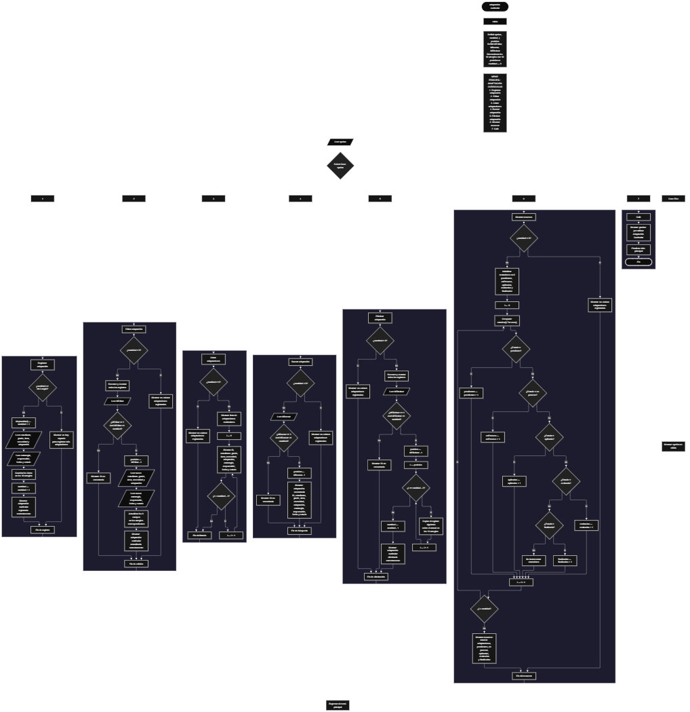

Este proyecto, llamado <b>adaptación curricular</b>, fue desarrollado en <b>visual basic .net</b> como un ejercicio práctico para fortalecer la lógica de programación mediante la creación de un sistema de gestión de adaptaciones curriculares desde la consola. El programa cuenta con un menú principal de siete opciones que permite <b>registrar, editar, eliminar, buscar, listar y consultar un resumen</b> de las adaptaciones curriculares registradas. Cada adaptación almacena información como el estudiante, el grado, el área, la necesidad educativa, la adaptación, la estrategia, el responsable, la fecha y el estado, utilizando arreglos con una capacidad máxima de <b>10 adaptaciones durante la ejecución</b>. Durante su desarrollo se aplicaron conceptos fundamentales de programación, como variables, arreglos, estructuras condicionales, ciclos repetitivos y estructuras de selección, además de procesos para buscar, modificar, eliminar y organizar registros. Este proyecto permite poner en práctica los conocimientos adquiridos en Visual Basic .NET y sirve como base para desarrollar sistemas de gestión educativa más avanzados utilizando otros lenguajes y tecnologías.

<h2 align="center">⚙️ Funcionamiento del menú principal</h2>

### ➕ Registrar adaptación

La opción <b>1) registrar adaptación</b> permite almacenar una nueva adaptación curricular en el sistema. Antes de realizar el registro, el programa comprueba que la cantidad de adaptaciones almacenadas sea menor que la capacidad máxima de los arreglos, utilizando la condición <b>cantidad &gt;= ids.Length</b>. Si se alcanza el límite de <b>10 registros</b>, muestra el mensaje <b>"no hay espacio para registrar mas adaptaciones."</b>, impidiendo agregar otro registro. Si existe espacio disponible, asigna un identificador mediante la instrucción <b>ids(cantidad) = cantidad + 1</b> y solicita los datos correspondientes al <b>estudiante, grado, área, necesidad, adaptación, estrategia, responsable, fecha y estado</b>. La información se almacena en la posición correspondiente de sus respectivos arreglos. Finalmente, aumenta la variable <b>cantidad</b> en uno y muestra el mensaje <b>"adaptacion curricular registrada correctamente."</b>.

### ✏️ Editar adaptación

La opción <b>2) editar adaptación</b> permite modificar la información de una adaptación curricular registrada. Primero, el programa comprueba si existen registros mediante la variable <b>cantidad</b>. Si no hay adaptaciones almacenadas, muestra el mensaje <b>"no existen adaptaciones registradas."</b>. En caso contrario, utiliza un ciclo <b>For...Next</b> para presentar una lista con el ID, estudiante, grado, área, necesidad, adaptación, estrategia, responsable, fecha y estado de cada registro. Después, solicita el ID de la adaptación que se desea editar y comprueba que se encuentre dentro del rango permitido mediante la condición <b>idEditar &gt;= 1 And idEditar &lt;= cantidad</b>. Si el identificador es válido, calcula la posición mediante <b>idEditar - 1</b> y solicita los nuevos datos del estudiante, grado, área, necesidad, adaptación, estrategia, responsable, fecha y estado, actualizando directamente los valores de los arreglos correspondientes. Finalmente, muestra el mensaje <b>"adaptacion curricular actualizada correctamente."</b>. Si el ID introducido no se encuentra dentro del rango permitido, presenta el mensaje <b>"ID no encontrada."</b>.

### 🗑️ Eliminar adaptación

La opción <b>5) eliminar adaptación</b> permite eliminar una adaptación curricular mediante su identificador. Antes de comenzar, el programa comprueba si existen registros almacenados. Si no hay adaptaciones, muestra el mensaje <b>"no existen adaptaciones registradas."</b>. Si existen registros disponibles, presenta una lista con los datos de cada adaptación curricular. Después, solicita el ID que se desea eliminar y comprueba que se encuentre dentro del rango permitido mediante la condición <b>idEliminar &gt;= 1 And idEliminar &lt;= cantidad</b>. Si el identificador es válido, calcula la posición correspondiente utilizando <b>idEliminar - 1</b> e inicia el proceso de eliminación. Para mantener organizados los registros, utiliza un ciclo <b>For...Next</b> que desplaza una posición hacia la izquierda los datos posteriores en los diez arreglos: <b>ids, estudiantes, grados, areas, necesidades, adaptaciones, estrategias, responsables, fechas y estados</b>. Posteriormente, disminuye la variable <b>cantidad</b> en uno y muestra el mensaje <b>"adaptacion curricular eliminada correctamente."</b>. Si el ID introducido no corresponde a un registro dentro del rango permitido, presenta el mensaje <b>"ID no encontrada."</b>.

### 🔎 Buscar adaptación

La opción <b>4) buscar adaptación</b> permite localizar una adaptación curricular mediante su identificador. Primero, el programa comprueba si existen adaptaciones registradas. Si no hay registros, muestra el mensaje <b>"no existen adaptaciones registradas."</b>. En caso contrario, solicita el ID de la adaptación que se desea buscar y verifica que se encuentre dentro del rango permitido mediante la condición <b>idBuscar &gt;= 1 And idBuscar &lt;= cantidad</b>. Si la selección es válida, calcula la posición utilizando <b>idBuscar - 1</b> y muestra el mensaje <b>"adaptacion encontrada"</b>, seguido de toda la información almacenada: estudiante, grado, área, necesidad, adaptación, estrategia, responsable, fecha y estado. Si el ID introducido no se encuentra dentro del rango permitido, presenta el mensaje <b>"ID no encontrada."</b>.

### 📋 Listar adaptaciones

La opción <b>3) listar adaptaciones</b> permite visualizar todas las adaptaciones curriculares registradas actualmente en el sistema. Antes de mostrar la información, el programa comprueba si la variable <b>cantidad</b> es igual a cero. Si no existen registros, presenta el mensaje <b>"no existen adaptaciones registradas."</b>. Si hay adaptaciones disponibles, muestra el título <b>"lista de adaptaciones curriculares"</b> y utiliza un ciclo <b>For...Next</b> para recorrer los arreglos desde la primera posición hasta el número total de registros almacenados. Durante el recorrido, presenta el ID, estudiante, grado, área, necesidad, adaptación, estrategia, responsable, fecha y estado de cada adaptación. Esta función facilita consultar los registros existentes sin necesidad de buscar cada adaptación individualmente.

### 📊 Mostrar resumen

La opción <b>6) mostrar resumen</b> permite consultar un resumen general de las adaptaciones curriculares registradas. Primero, el programa comprueba si existen registros almacenados. Si no hay adaptaciones, muestra el mensaje <b>"no existen adaptaciones registradas."</b>. En caso contrario, inicializa cinco contadores: <b>pendientes, enProceso, aplicadas, evaluadas y finalizadas</b>. Después, utiliza un ciclo <b>For...Next</b> para recorrer los estados almacenados en el arreglo <b>estados</b>. Mediante estructuras condicionales <b>If...ElseIf</b> y el método <b>ToLower()</b>, compara cada estado con los valores <b>"pendiente", "en proceso", "aplicada", "evaluada" y "finalizada"</b>. Cuando encuentra una coincidencia, incrementa el contador correspondiente. Finalmente, muestra el total de adaptaciones registradas y la cantidad correspondiente a cada estado, facilitando conocer la situación general de las adaptaciones curriculares.

### 🚪 Salir del menú principal

La opción <b>7) salir</b> permite finalizar la ejecución del programa y muestra el mensaje <b>"gracias por utilizar adaptacion curricular."</b>. El menú principal se encuentra dentro de una estructura repetitiva <b>Do...Loop While</b>, que mantiene el programa en funcionamiento mientras la opción seleccionada sea diferente de <b>7</b>. Cuando el usuario selecciona esta opción, se ejecuta el mensaje de despedida y la condición <b>opcion &lt;&gt; 7</b> deja de cumplirse, finalizando el ciclo y terminando la ejecución del programa.

<h2 align="center">🧠 Temas aplicados en el proyecto</h2>

### 📦 Variables

En este proyecto se utilizan variables para almacenar la opción seleccionada en el menú, controlar la cantidad de adaptaciones registradas, recorrer los arreglos, identificar la posición de una adaptación que se desea editar, buscar o eliminar y contabilizar los diferentes estados durante la generación del resumen. Cada variable cumple una función específica dentro de las operaciones de gestión de adaptaciones curriculares.

🔢 **Opcion:** Almacena la opción seleccionada por el usuario en el menú principal.

📊 **Cantidad:** Controla la cantidad actual de adaptaciones curriculares registradas.

🔄 **I:** Funciona como contador en los ciclos `For...Next` y permite recorrer las posiciones de los arreglos.

🔎 **IdEditar:** Almacena el identificador de la adaptación que se desea modificar.

🔍 **IdBuscar:** Almacena el identificador de la adaptación que se desea localizar.

🗑️ **IdEliminar:** Almacena el identificador de la adaptación que se desea eliminar.

📍 **Posicion:** Determina la posición del registro seleccionado dentro de los arreglos mediante la operación `ID - 1`.

📈 **Pendientes:** Cuenta las adaptaciones cuyo estado es pendiente.

⚙️ **EnProceso:** Cuenta las adaptaciones cuyo estado es en proceso.

✅ **Aplicadas:** Cuenta las adaptaciones cuyo estado es aplicada.

📋 **Evaluadas:** Cuenta las adaptaciones cuyo estado es evaluada.

🏁 **Finalizadas:** Cuenta las adaptaciones cuyo estado es finalizada.

### 🗃️ Arreglos

En este proyecto se utilizan diez arreglos relacionados con la información de cada adaptación curricular. Cada arreglo tiene una capacidad de <b>10 posiciones</b> y utiliza el mismo índice para representar los datos correspondientes a un mismo registro. Por ejemplo, la información de una adaptación almacenada en la posición <b>0</b> se encuentra distribuida entre <b>ids(0), estudiantes(0), grados(0), areas(0), necesidades(0), adaptaciones(0), estrategias(0), responsables(0), fechas(0) y estados(0)</b>. Esta organización permite recorrer, buscar, modificar, mostrar y eliminar las adaptaciones de manera ordenada.

🔢 **Ids(10):** Almacena los identificadores de las adaptaciones curriculares.

👨‍🎓 **Estudiantes(10):** Almacena los nombres de los estudiantes.

🎓 **Grados(10):** Almacena los grados académicos de los estudiantes.

📚 **Areas(10):** Almacena las áreas educativas relacionadas con las adaptaciones.

📝 **Necesidades(10):** Almacena las necesidades educativas de los estudiantes.

📋 **Adaptaciones(10):** Almacena las adaptaciones curriculares correspondientes.

💡 **Estrategias(10):** Almacena las estrategias utilizadas en cada adaptación.

👤 **Responsables(10):** Almacena los responsables de las adaptaciones curriculares.

📅 **Fechas(10):** Almacena las fechas correspondientes a cada adaptación.

📊 **Estados(10):** Almacena los estados actuales de las adaptaciones curriculares.

### 🔀 Estructuras condicionales

En este proyecto se utilizan las estructuras <b>If...Else</b> y <b>If...ElseIf...Else</b> para controlar las diferentes operaciones del sistema. Estas condiciones permiten comprobar si existe espacio disponible antes de registrar una adaptación, verificar si hay registros antes de ejecutar determinadas operaciones, validar los identificadores seleccionados para editar, buscar o eliminar y determinar a qué categoría pertenece cada estado durante la generación del resumen. De esta manera, el programa puede responder de forma diferente según la información almacenada y las decisiones del usuario.

### 🔄 Estructuras repetitivas

En este proyecto se utilizan las estructuras repetitivas <b>Do...Loop While</b> y <b>For...Next</b>. El ciclo <b>Do...Loop While</b> mantiene activo el menú principal y permite ejecutar diferentes operaciones hasta que el usuario selecciona la opción de salida. Por otro lado, los ciclos <b>For...Next</b> permiten recorrer los arreglos para mostrar las adaptaciones registradas, presentar los datos antes de editarlos o eliminarlos y contabilizar los estados durante la generación del resumen. También se utilizan para desplazar los registros posteriores una posición hacia la izquierda cuando se elimina una adaptación curricular.

### 🎯 Estructura de selección

El programa utiliza la estructura <b>Select Case</b> para evaluar el valor almacenado en la variable <b>opcion</b> y ejecutar el bloque de instrucciones correspondiente. Cada caso representa una operación específica del sistema: <b>registrar, editar, listar, buscar, eliminar, mostrar resumen o salir</b>. También se utiliza el bloque <b>Case Else</b> para mostrar el mensaje <b>"opcion no valida."</b> cuando el usuario introduce un número que no coincide con ninguna de las opciones definidas en el menú principal.

### 🔢 Dimensionamiento de arreglos

El programa utiliza la declaración de arreglos para establecer la capacidad de almacenamiento de la información de las adaptaciones curriculares. Se definieron diez arreglos con el límite superior <b>9</b>, lo que proporciona <b>10 posiciones disponibles</b>, comprendidas entre los índices <b>0 y 9</b>. La cantidad de posiciones ocupadas se controla mediante la variable <b>cantidad</b>, por lo que las operaciones recorren únicamente los registros comprendidos entre la primera posición y el total actual de adaptaciones. Además, la propiedad <b>ids.Length</b> permite comprobar la capacidad disponible antes de registrar una nueva adaptación.

### 🔄 Reorganización de registros

Cuando se selecciona una adaptación curricular para eliminarla, el programa utiliza un ciclo <b>For...Next</b> que comienza en la posición seleccionada y continúa hasta <b>cantidad - 2</b>. En cada repetición, los datos de la posición siguiente se copian sobre la posición actual en los diez arreglos: <b>ids, estudiantes, grados, areas, necesidades, adaptaciones, estrategias, responsables, fechas y estados</b>. Después, la variable <b>cantidad</b> disminuye en uno para actualizar el número de registros activos. De esta manera, las adaptaciones posteriores ocupan las posiciones disponibles sin dejar espacios vacíos entre los registros activos. Sin embargo, los identificadores no se renumeran después del desplazamiento, por lo que la relación entre el ID y la posición puede dejar de coincidir.

<h2 align="center">¿Cómo se implementaron las operaciones crud en el proyecto?</h2>

Las operaciones <b>crud</b> se implementaron mediante las opciones del menú principal, permitiendo administrar las adaptaciones curriculares registradas. La operación <b>crear</b> corresponde a <b>registrar adaptación</b>, donde se introducen los datos de un nuevo registro; <b>leer</b> se realiza mediante las opciones <b>buscar adaptación, listar adaptaciones y mostrar resumen</b>, que permiten consultar la información almacenada y conocer la distribución de los estados; <b>actualizar</b> corresponde a <b>editar adaptación</b>, donde se modifican los datos de una adaptación existente; y <b>eliminar</b> se realiza mediante la opción <b>eliminar adaptación</b>, que retira un registro y reorganiza los arreglos. Estas operaciones utilizan variables, arreglos, estructuras condicionales y ciclos repetitivos para gestionar la información almacenada temporalmente durante la ejecución del programa.

<h2 align="center">Diagrama de flujo del proyecto</h2>

<h2 align="center">🛡️ Validaciones del programa</h2>

### 📭 No existen adaptaciones registradas

Esta validación se utiliza en las opciones de <b>editar, listar, buscar, eliminar y mostrar resumen</b>. El programa comprueba si la variable <b>cantidad</b> es igual a <b>0</b> y, si no existen adaptaciones curriculares registradas, muestra el mensaje <b>"no existen adaptaciones registradas."</b>. Esta comprobación evita continuar con las operaciones que necesitan información almacenada cuando no hay registros disponibles.

### ⚠️ Capacidad máxima alcanzada

Esta validación se utiliza durante el registro de nuevas adaptaciones curriculares para controlar la capacidad máxima de los arreglos. El programa comprueba si <b>cantidad &gt;= ids.Length</b> antes de permitir agregar un nuevo registro. Como los arreglos tienen diez posiciones, el sistema permite almacenar hasta <b>10 adaptaciones curriculares</b> durante la ejecución. Si se alcanza el límite, muestra el mensaje <b>"no hay espacio para registrar mas adaptaciones."</b>, impidiendo registrar otra adaptación mientras se mantenga la capacidad máxima.

### ❌ Identificador no encontrado

Esta validación se utiliza en las operaciones de <b>editar, buscar y eliminar adaptación</b>. El programa comprueba que el identificador introducido esté dentro del rango comprendido entre <b>1</b> y <b>cantidad</b>. Si el ID se encuentra dentro de ese rango, calcula la posición correspondiente mediante la operación <b>ID - 1</b> y continúa con la operación seleccionada. Si el identificador está fuera del rango permitido, muestra el mensaje <b>"ID no encontrada."</b>. Esta comprobación permite evitar el acceso a posiciones que no corresponden al rango de registros activos.

### 📊 Clasificación de estados

Esta validación se utiliza durante la opción <b>mostrar resumen</b>. El programa recorre el arreglo <b>estados</b> y compara cada valor mediante el método <b>ToLower()</b> con los estados <b>"pendiente", "en proceso", "aplicada", "evaluada" y "finalizada"</b>. Cuando encuentra una coincidencia, incrementa el contador correspondiente. Esta comparación permite reconocer los estados aunque se introduzcan con diferentes combinaciones de mayúsculas y minúsculas. Sin embargo, los valores que no coincidan exactamente con estas categorías no se contabilizan en el resumen.

### ⚠️ Entrada numérica

El programa utiliza <b>Convert.ToInt32(Console.ReadLine())</b> para convertir las entradas del usuario en valores numéricos, tanto en la selección del menú como en los identificadores de las adaptaciones. Sin embargo, el código no incorpora una comprobación previa mediante <b>Integer.TryParse()</b>. Por este motivo, si el usuario introduce letras, símbolos o un valor que no puede convertirse a número, puede producirse una excepción durante la ejecución del programa.

### ⚠️ Identificadores después de eliminar

Durante la eliminación de una adaptación curricular, el programa desplaza los datos de los registros posteriores una posición hacia la izquierda, pero conserva los identificadores originales. Debido a que las operaciones de edición, búsqueda y eliminación calculan la posición utilizando <b>ID - 1</b>, después de eliminar un registro intermedio el identificador puede dejar de corresponder con la posición real de la adaptación. Por esta razón, algunas operaciones podrían acceder a una adaptación diferente de la seleccionada. Esta situación representa un aspecto que se puede mejorar en futuras versiones del proyecto.

### ⚠️ Opción inválida

La estructura <b>Select Case</b> incluye el bloque <b>Case Else</b>, que muestra el mensaje <b>"opcion no valida."</b> cuando el usuario introduce un número que no corresponde a ninguna de las siete opciones definidas en el menú principal. Esta comprobación permite informar al usuario cuando selecciona una opción que no está disponible.

<h2 align="center">🎯 Objetivo del proyecto</h2>

El objetivo principal de este proyecto es fortalecer la <b>lógica de programación</b> mediante el desarrollo de un sistema de gestión de adaptaciones curriculares en <b>visual basic .net</b>. A través de su construcción se busca aplicar los conocimientos adquiridos sobre variables, arreglos, estructuras condicionales, ciclos repetitivos y estructuras de selección, integrándolos para resolver un problema de manera organizada. Además, el proyecto permite comprender cómo registrar, consultar, modificar y eliminar información relacionada con estudiantes y sus adaptaciones educativas, así como generar resúmenes según los estados de cada registro. De esta manera, se establece una base para desarrollar sistemas de gestión educativa más completos con otros lenguajes y tecnologías.

